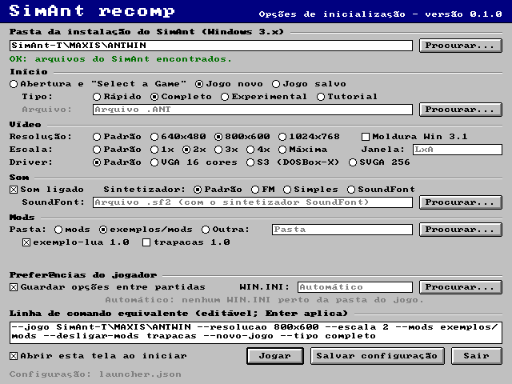

*Read in English: [README.md](README.md)*

# SimAnt recomp

Reimplementação moderna do **SimAnt: The Electronic Ant Colony** (Maxis, 1991, versão Windows 3.x) em
Rust + SDL2, para Windows e Linux atuais. A lógica do jogo é reescrita a partir de uma especificação
escrita, conferida tick a tick contra o jogo original rodando num emulador; gráficos, sons, músicas,
textos e ajuda são lidos da **sua cópia** do SimAnt, que este projeto não distribui. O port pode ser
modificado por mods (dados JSON e scripts Lua em sandbox).



> **Aviso legal.** Este é um projeto de fãs, sem fins lucrativos, **sem afiliação nem endosso da Maxis
> ou da Electronic Arts**. "SimAnt" e "Maxis" são marcas de seus donos. Este repositório e os seus
> lançamentos **não contêm nenhum arquivo do jogo original** (gráficos, sons, músicas, textos,
> executável): para jogar, você precisa ter o SimAnt para Windows 3.x. Não peça nem compartilhe cópias
> do jogo nos canais do projeto.

## Situação

A versão **1.0.0** foi lançada em 2026-10-20 (ver o [histórico de versões](CHANGELOG.pt-BR.md)), com a
API de mods congelada em **1.0**. O que funciona:

- Os quatro modos do original: Tutorial, Quick Game, Full Game (quintal e casa, com troca de patch) e
  Experimental.
- Simulação igual à do original, tick a tick: centenas de vetores de tick gravados do jogo original são
  reproduzidos bit a bit pelos testes.
- As telas e janelas do original, comparadas pixel a pixel com capturas do original; saves no formato
  `.ANT` do original (o save gravado pelo port abre no SimAnt); a ajuda, os códigos de trapaça, os
  efeitos sonoros e as músicas do original.
- Conveniências de hoje: ampliação nítida por inteiros, tela virtual de 640×480, 800×600 ou 1024×768, a
  barra de título do Windows 3.1 como moldura da janela (ligada por padrão), launcher de inicialização em
  inglês e português, músicas por um sintetizador simples por padrão (FM e SoundFont opcionais),
  preferências guardadas entre partidas, mods (dados e scripts Lua em sandbox).

O que ainda falta ou difere está em [`docs/pt-BR/estado-do-projeto.md`](docs/pt-BR/estado-do-projeto.md)
(situação do projeto) e [`docs/pt-BR/divergencias.md`](docs/pt-BR/divergencias.md) (divergências
conhecidas em relação ao original).

## Idiomas

O launcher tem inglês e português; o jogo em si é em inglês, como o original (os textos próprios do
port passam pelo frame de idiomas em `data/idiomas/`, [`docs/pt-BR/i18n.md`](docs/pt-BR/i18n.md), para
que outros idiomas possam ser acrescentados, inclusive por mods). A documentação do
projeto é em inglês, com todos os documentos também em português (o link na primeira linha de cada
arquivo).

## Jogar

### Baixar

Baixe o pacote do seu sistema na [página de releases](https://github.com/Tim-campy/simant-recomp/releases)
(`.zip` para Windows x64, `.tar.gz` para Linux x64) e descompacte numa pasta qualquer. O pacote traz o
executável, os dados do port, mods de exemplo e um guia de quem joga (`LEIAME.txt` em português,
`README.txt` em inglês — o mesmo texto de [`LEIAME-usuario.md`](LEIAME-usuario.md) e
[`README-user.md`](README-user.md)).

### Requisitos

- **Windows 10 ou 11, 64 bits:** nada além do pacote (o `SDL2.dll` já vem junto).
- **Linux x86-64** (glibc 2.35 ou mais nova) com o **SDL2** do sistema: `sudo apt install libsdl2-2.0-0`
  (Debian/Ubuntu), `sudo dnf install SDL2` (Fedora), `sudo pacman -S sdl2-compat` (Arch).
- **Os arquivos do seu SimAnt para Windows 3.x:** a pasta do jogo instalado (em geral `C:\MAXIS\ANTWIN`)
  com `SHARED.NDX/.DAT` e `WINGANT.NDX/.DAT` (obrigatórios), `SOUND.NDX/.DAT` e a pasta `SOUND` (som e
  música), `SIMANTW.EXE` (cursores; só lido, nunca executado), `SIMANT.HLP` (ajuda), `FONTRES.FON` e
  `FONT1`–`FONT4` (fontes). O port só lê esses arquivos e nunca os altera.

### O launcher

Rode o `simant.exe` (Windows) ou o `simant` (Linux). Sem opções, ele abre a tela de opções de
inicialização (`simant/src/launcher/`, desenhada em SDL2 sem nada do jogo original; a captura acima foi
gravada por `simant --capturar-launcher`): pasta da instalação do SimAnt (seletor de pastas do sistema,
conferida: `SHARED.NDX`, `WINGANT.NDX`...), início (abertura, jogo novo de cada tipo ou save), vídeo,
perfil de driver, som e sintetizador, pasta de mods e cada mod ligado ou não, preferências e a **linha
de comando equivalente**, editável. As escolhas ficam em `launcher.json` na pasta de dados do usuário e
valem também para o `simant` rodado com opções, que vencem (`simant/src/config_launcher.rs`; decisão em
[`docs/pt-BR/decisoes.md`](docs/pt-BR/decisoes.md)). No Windows, o executável de lançamento não abre
console: a saída vai para `simant.log` e os erros fatais aparecem numa caixa de mensagem (`--console`
liga um console). `data/` e `mods/` são procurados ao lado do executável (e depois na pasta atual).

### Como se joga

Você é a **formiga amarela** de uma colônia preta, contra as vermelhas, no quintal de uma casa. Os modos
(escolhidos no "Select a Game"; Enter = Full Game, como no original) são Tutorial, Quick Game, Full Game
e Experimental; ver [`telas/abertura.md`](docs/pt-BR/spec/telas/abertura.md),
[`telas/quintal.md`](docs/pt-BR/spec/telas/quintal.md) e
[`telas/experimental.md`](docs/pt-BR/spec/telas/experimental.md).

- **Mouse:** clique numa célula leva a amarela até lá; **duplo clique** age (ataca, pede comida, pega ou
  larga, cava). Segurar o botão sobre a amarela abre o menu dela. **Espaço/Insert** clicam onde está o
  cursor.
- **Teclas da amarela:** **1**/**2** recrutam 5/10 operárias (Ctrl+2: todas), **3**/**4** liberam
  metade/todas, **0** alarme, **X** ou F9 troca de corpo, **Backspace** cancela, **Home** centraliza.
- **Velocidade e partida:** **Shift+0** pausa, **Shift+1..4** lenta/normal/rápida/ultra (rápida e ultra
  a 2,5× e 5× a normal; sem o foco da janela, a lenta — escolhas do usuário, configuráveis), **Ctrl+G**
  AutoTrack, **Ctrl+S** salva, **Ctrl+A** salva como, **Ctrl+L** carrega um `.ANT`, **Ctrl+N** jogo
  novo. O `.ANT` gravado é aceito pelo SimAnt original.
- **Vista:** **Ctrl + setas** rolam a janela de edição (as setas sozinhas e PageUp/PageDown também,
  extensão do port); **Ctrl+8/9/0** ou os botões *Surface*/*Nest* da faixa trocam de plano.
- **Janelas:** **Ctrl+E** edição, **Ctrl+B** Behavior Control, **Ctrl+C** Caste Control, **Ctrl+H**
  History, **Ctrl+I** Info, **Ctrl+M** mapa (ou o quintal, se aberto), **Ctrl+Y/5/6/7** quintal nos
  modos quintal, casa, estratégico e gráfico. No quintal, duplo clique num patch troca de patch (Full
  Game). Gerenciador: **Ctrl+F4** fecha, **Ctrl+F6** próxima, **Ctrl+Espaço** menu de sistema,
  **Ctrl+Z** maximiza a edição.
- **Faixa:** os botões configuráveis da segunda linha (Ctrl+clique troca a função), os marcadores 1–7
  (Ctrl+clique guarda a vista), as barras de saúde (clique abre o quadro das castas) e, no Experimental,
  o menu de ferramentas.
- **Ajuda:** **F1** abre o `SIMANT.HLP`; **Shift+F1**, **Delete**, o clique direito ou os botões *?*
  ligam o modo de ajuda (o próximo clique abre o tópico do que foi clicado).
- **Códigos de trapaça do original:** digite 4 letras na partida (`heal`, `just`, `qeen`, `eggs`...);
  lista em [`regras/trapacas.md`](docs/pt-BR/spec/regras/trapacas.md).

Todas as teclas vêm de `data/partida.json`, `data/navegacao.json`, `data/janelas.json`,
`data/quintal_mapa.json` e `data/ajuda_contexto.json`. O que ainda falta para quem joga está em
[`docs/pt-BR/estado-do-projeto.md`](docs/pt-BR/estado-do-projeto.md) §4.

## Opções de linha de comando

| Opção | Efeito |
|---|---|
| `--jogo DIR`, `--dados DIR`, `--mods DIR` | pastas do jogo (padrão: a do launcher, `SIMANT_DIR` ou `SimAnt-T/MAXIS/ANTWIN`), dos dados (`data`) e dos mods (`mods`), relativas à pasta do executável (ou à atual, se lá não houver `data/`) |
| `--desligar-mods A,B` | não carrega esses mods (nomes do `mod.json`) |
| `--launcher`, `--config ARQ`, `--sem-config` | abre o launcher; outro `launcher.json`; ignora a configuração do launcher |
| `--console`, `--capturar-launcher ARQ.png` | (Windows, executável de lançamento) mensagens num console em vez do `simant.log`; grava a tela do launcher sem abrir janela |
| `--novo-jogo`, `--tipo T`, `--semente N` | jogo novo do tipo `tutorial`, `rapido` (padrão), `completo` ou `experimental`, com semente fixa (reproduzível) |
| `--save ARQ.ANT`, `--salvar ARQ.ANT` | abre um save; `--salvar` grava o estado no fim de uma execução sem janela e, na janela, é o nome do "salvar como" (Ctrl+A; sem ele, `SALVO01.ANT`, `SALVO02.ANT`...) |
| `--resolucao LxA` | tela virtual do Windows 3.1: `640x480` (padrão), `800x600` ou `1024x768`; muda o layout como o original (janelas na tabela de posições da resolução, mais área livre em volta), sem escalar nada ([`telas/resolucao.md`](docs/pt-BR/spec/telas/resolucao.md)) |
| `--escala N`, `--janela LxA` | ampliação da tela virtual (inteira, nítida) e tamanho inicial da janela; `0` = a maior que cabe |
| `--moldura`, `--sem-moldura` | liga ou desliga a barra de título e o menu de sistema do Windows 3.1 em cima da barra de menus (`moldura_windows31`, ligada por padrão); ligada, ela substitui a moldura do sistema. Os testes e exportações (opções da última linha da tabela, `--ticks`, `--avancar-ms`, `--salvar`) ficam sem ela, como antes, a menos que `--moldura` seja dado |
| `--moldura-do-sistema`, `--sem-moldura-do-sistema` | com `--moldura`, manter a moldura do sistema (a barra fica dentro dela) ou trocá-la pela do Windows 3.1 (padrão; `substituir_moldura_do_sistema`) |
| `--velocidades proporcional\|original` | ritmo de Fast/Ultra: 2,5× e 5× a Normal (padrão, escolha do usuário) ou o do laço do original no 486 da bancada (`data/partida.json` → `relogio.ritmo_velocidades`) |
| `--sem-foco lenta\|original` | sem o foco, a simulação anda na Slow e volta à velocidade escolhida com o foco (padrão), ou mantém o ritmo como o original (`relogio.sem_foco_velocidade`); a velocidade do save e do menu não muda |
| `--perfil-driver NOME` | perfil de driver de vídeo imitado (`vga`, `svga256`, `s3_dosbox`; `data/resolucao.json` → `perfis_driver`) |
| `--sem-som` (`--com-som`), `--sintetizador NOME`, `--soundfont ARQ.sf2` | sem áudio (ou com, vencendo o launcher); sintetizador das músicas: `simples` (padrão de `data/som.json`, escolha do usuário: o que soa mais parecido com o original para ele), `fm` (FM próprio no estilo do OPL da Sound Blaster, banco `data/opl_banco.json`; o mais perto da captura do original pelas medidas) ou `soundfont` (SoundFont General MIDI, ou `SIMANT_SOUNDFONT`) |
| `--preferencias ARQ`, `--sem-preferencias` | arquivo das opções guardadas entre partidas (no lugar do `[SimAnt]` do `WIN.INI`; padrão em `%APPDATA%\SimAnt recomp\SimAnt\`) |
| `--win-ini ARQ` | `WIN.INI` lido (só leitura) como origem das opções enquanto o arquivo acima não existe; padrão: `WINDOWS/WIN.INI` na pasta do jogo ou nas duas de cima |
| `--ticks N`, `--avancar-ms MS`, `--acoes A,B`, `--quintal M`, `--janela-mapa M`, `--mini-mapa N` | testes sem interação: roda ticks, passa tempo real, aplica ações de navegação, abre o quintal, o mapa num modo ou o mini mapa (N aberturas) |
| `--exportar-tela-jogo ARQ.png`, `--exportar-telas DIR`, `--exportar-som DIR [--exportar-musica ID]`, `--capturar-janela ARQ.png`, `--sair-apos-ms N` | grava a tela de jogo, as telas da abertura, os efeitos e músicas em WAV, ou o que a janela mostrava |

### Opções de vídeo (`data/video.json`)

```json
{"resolucao_virtual": [640, 480], "escala": 1, "janela": null, "redimensionavel": true, "escala_inteira": true, "moldura_windows31": true, "substituir_moldura_do_sistema": true}
```

- `resolucao_virtual`: a resolução do Windows 3.1 que o port imita. O SimAnt original não amplia nada:
  numa tela maior, sobra mais área em volta e algumas janelas (título, Caste/Behavior, Info, fim de
  jogo, quintal) mudam de lugar, pela tabela de posições que o próprio jogo escolhe pela altura da tela
  (até 480 linhas uma, acima outra). `[640, 480]` é o padrão (a bancada); `[800, 600]` é a do DOSBox-X
  de referência; `[1024, 768]` usa as mesmas posições do 800×600 com mais área livre. A regra fica em
  `data/resolucao.json`.
- `escala`, `janela`, `redimensionavel`, `escala_inteira`: como a tela virtual aparece no monitor —
  ampliada por múltiplos inteiros (pixels nítidos, tarjas em volta) ou, com `escala_inteira: false`,
  ocupando o máximo com a proporção.
- `moldura_windows31`: desenha, em cima da barra de menus, a barra de título da janela principal como o
  Windows 3.1 a mostra com o SimAnt maximizado (caixa do menu de sistema, "SimAnt", minimizar e
  restaurar); a janela passa a ter a tela imitada inteira (640 × 480 em escala 1). O menu de sistema
  abre pela caixa ou por Alt+Espaço: Minimize minimiza a janela, Close faz a pergunta do Quit, Restore
  restaura a janela se ela estiver maximizada, Switch To não faz nada. Padrão `true` na 1.0 (escolha do
  usuário; até então `false`); as execuções sem interação (`--exportar-telas`, `--exportar-tela-jogo`,
  `--ticks`, `--avancar-ms`, `--salvar`, `--sair-apos-ms`, `--capturar-janela`, `--exportar-som`) ficam
  sem a moldura se `--moldura` não for dado, para produzir o mesmo de antes
  ([`telas/menus.md`](docs/pt-BR/spec/telas/menus.md) §8, [`decisoes.md`](docs/pt-BR/decisoes.md)).
- `substituir_moldura_do_sistema` (extensão do port, escolha do usuário; padrão `true`): com a moldura
  ligada, a janela fica **sem a borda do sistema** e a barra do Windows 3.1 é a moldura de verdade:
  arrastar pela faixa do título move a janela, duplo clique nela maximiza ou restaura, o botão da
  direita maximiza (seta para cima) ou restaura, minimizar minimiza, o menu de sistema troca
  Restore/Maximize conforme o estado e Alt+F4 faz a pergunta do Quit. Restaurada, a janela tem a moldura
  grossa de 4 pixels do Windows 3.1 rente às bordas, que redimensiona pelas bordas e cantos (o jogo fica
  centrado dentro dela); maximizada, o jogo é ampliado por inteiros na área útil do monitor. Os botões e
  o menu de sistema funcionam sempre — também com um diálogo ou aviso aberto e no "Select a Game" (no
  original eles ficam parados ali) —, e fechar (Close, duplo clique na caixa, Alt+F4) faz sempre a
  pergunta do Quit, cancelando o diálogo que estiver aberto. `false` = a barra dentro da janela do
  sistema.
- A linha de comando (`--resolucao`, `--escala`, `--janela`, `--moldura`, `--sem-moldura`,
  `--moldura-do-sistema`, `--sem-moldura-do-sistema`) vence o arquivo; um mod pode trazer o seu
  `video.json`.

A lista completa, com as opções de depuração, está no comentário do topo de `simant/src/main.rs` e em
`simant/src/opcoes.rs`.

## Mods

Um mod é uma pasta em `mods/` com um `mod.json` (`nome`, `versao`, `dependencias`, `scripts`). Ele pode
trocar objetos do banco original (`objetos/<tipo>/<id>.bin`), arquivos de dados do port
(`data/<nome>.json`, mesclados por chave: o mod traz só o que muda), arquivos soltos do jogo
(`arquivos/<nome>`) e trazer scripts Lua em sandbox com ganchos (`ao_iniciar`, `depois_do_tick`,
`ao_evento`, `ao_menu`, ganchos dentro do tick como `antes_superficie`...), escritas validadas (comida,
cheiros, castas, formigas nos ninhos) e estado próprio guardado ao lado do save (`JOGO.ANT.mods.json`;
o `.ANT` continua o do original). A API, a lista de arquivos sobrescrevíveis e o histórico de
compatibilidade estão em [`docs/pt-BR/api-mods.md`](docs/pt-BR/api-mods.md) (versão atual no topo).

Exemplos em `exemplos/mods/` (fora de `mods/`, para não mudar o jogo por padrão): `exemplo-lua/` (chuva
de comida a cada 500 ticks) e `trapacas/` (menu **F12** para provocar chuva, revoada, menino, gato, fim
de jogo, castas, alarme, soldados no ninho, avançar ticks, painel de depuração; a contagem de trapaças
vai para o save). Para ligar: `--mods exemplos/mods`.

## Compilar a partir do código

Só é preciso para mudar o código ou compilar para um sistema sem pacote pronto; quem só quer jogar pode
baixar a [última versão](https://github.com/Tim-campy/simant-recomp/releases/latest). Em todos os casos
você precisa da **sua própria cópia do SimAnt para Windows 3.x** (ver [Requisitos](#requisitos)).

### 1. Instale as ferramentas

**Windows 10/11 (x64)**

1. [Git](https://git-scm.com/download/win).
2. [Visual Studio Build Tools](https://visualstudio.microsoft.com/visual-cpp-build-tools/) com a carga de
   trabalho **"Desenvolvimento para desktop com C++"** (o linker do MSVC e o compilador C usado para o
   Lua embutido).
3. [Rust](https://rustup.rs/) pelo `rustup-init.exe`, aceitando a toolchain padrão (stable, MSVC).

**Linux (x64)**

```bash
# Debian / Ubuntu
sudo apt install build-essential git curl libsdl2-dev
# Fedora
sudo dnf install gcc git curl SDL2-devel
# Rust (qualquer distribuição)
curl --proto '=https' --tlsv1.2 -sSf https://sh.rustup.rs | sh
```

### 2. Baixe o código

```bash
git clone https://github.com/Tim-campy/simant-recomp.git
cd simant-recomp
```

### 3. SDL2 (só no Windows)

No Windows a compilação liga com o pacote oficial de desenvolvimento do SDL2 2.30.9, que não fica no
repositório. Baixe uma vez em `vendor/` (PowerShell, dentro da pasta do projeto):

```powershell
mkdir vendor
curl.exe -L -o vendor\SDL2-devel-2.30.9-VC.zip https://github.com/libsdl-org/SDL/releases/download/release-2.30.9/SDL2-devel-2.30.9-VC.zip
tar -xf vendor\SDL2-devel-2.30.9-VC.zip -C vendor
```

Deve existir `vendor\SDL2-2.30.9\lib\x64\SDL2.dll`. No Linux é usado o `libsdl2-dev` do sistema,
instalado no passo 1.

### 4. Compile e rode

```bash
cargo build --release
```

A primeira compilação baixa as dependências do Rust e leva alguns minutos. O resultado é
`target/release/simant.exe` no Windows (com o `SDL2.dll` copiado ao lado) ou `target/release/simant` no
Linux. Para rodar:

```bash
cargo run --release -p simant                                  # abre o launcher
cargo run --release -p simant -- --novo-jogo --tipo completo   # direto num Jogo Completo novo
cargo run --release -p simant -- --help                        # todas as opções
```

Na primeira vez, aponte no launcher a pasta da sua instalação do SimAnt (a que tem `SIMANTW.EXE`,
`SHARED.DAT`, `WINGANT.DAT`, `SOUND.DAT`...). Também dá para colocar essa pasta em
`SimAnt-T/MAXIS/ANTWIN/` dentro do projeto, passar `--jogo <pasta>` ou definir a variável de ambiente
`SIMANT_DIR`. Nada na pasta do jogo é alterado.

### 5. Monte uma pasta portátil (opcional)

O executável acha a pasta `data/` ao lado dele, então uma pasta jogável só precisa de:

```
simant.exe        (ou simant no Linux)
SDL2.dll          (só no Windows)
data/
exemplos/mods/    (opcional: os mods de exemplo)
```

É o que os pacotes de lançamento contêm (montados por `.github/workflows/release.yml`, que também
acrescenta as licenças e os avisos de terceiros).

### Testes

```
cargo test --workspace
cargo clippy --workspace --all-targets -- -D warnings
```

Os testes com arquivos reais procuram o jogo em `SIMANT_DIR` ou em `SimAnt-T/MAXIS/ANTWIN` e avisam e
passam sem eles. Os vetores do original (`tests/referencias/`, ver o
[`README`](tests/referencias/README.pt-BR.md) de lá e
[`regras/testes-tick.md`](docs/pt-BR/spec/regras/testes-tick.md)) exigem igualdade bit a bit do estado
depois de cada tick (`engine/tests/ticks_originais.rs`, `ticks_longos.rs`). A bancada que roda o
original no QEMU está em [`docs/pt-BR/bancada-qemu.md`](docs/pt-BR/bancada-qemu.md); os extratores das
tabelas do executável estão em `tools/` (`tools/conferir_extracoes.py SIMANTW.EXE` confere que
reproduzem os `data/*.json`).

### Organização

| Pasta | Conteúdo |
|---|---|
| `engine/` | crate sem janela: `formats` (formatos originais), `rules` (simulação), `core` (telas, janelas, partida), `recursos` (original + mods), `scripts` (Lua) |
| `simant/` | executável SDL2 (vídeo, áudio, entrada) |
| `data/` | dados do port (tabelas das regras, telas, teclas, textos): é o que os mods sobrescrevem |
| `exemplos/mods/` | mods de exemplo |
| `tools/` | extratores e inspetores em Python, bancada QEMU, comparação de capturas |
| `tests/referencias/` | vetores, casos e roteiros gravados do original |
| `referencia/` | configuração do DOSBox-X para rodar o original |
| `docs/` | especificação, decisões, glossário, divergências, API de mods, estado do projeto (em português em `docs/pt-BR/`) |

## Documentação

- [`docs/pt-BR/spec/`](docs/pt-BR/spec/README.md) — a especificação: formatos de arquivo, telas e regras
  do original, com a evidência de cada afirmação.
- [`docs/pt-BR/estado-do-projeto.md`](docs/pt-BR/estado-do-projeto.md) — situação do projeto: o que
  está feito, conferido e faltando.
- [`docs/pt-BR/divergencias.md`](docs/pt-BR/divergencias.md) — onde o original difere da documentação
  dele ou do port, e como isso foi observado.
- [`docs/pt-BR/decisoes.md`](docs/pt-BR/decisoes.md) — registro de decisões (data, decisão, motivo,
  alternativas descartadas).
- [`docs/pt-BR/glossario.md`](docs/pt-BR/glossario.md) — glossário dos nomes internos do original.
- [`docs/pt-BR/api-mods.md`](docs/pt-BR/api-mods.md) — API de mods.
- [`docs/pt-BR/bancada-qemu.md`](docs/pt-BR/bancada-qemu.md) — a bancada QEMU que roda o original.
- [`docs/pt-BR/lancamento.md`](docs/pt-BR/lancamento.md) — checklist de lançamento.

## Como contribuir

Contribuições são bem-vindas. O projeto segue um método rigoroso: especificação antes do código, o jogo
original como oráculo e nenhuma afirmação sobre o comportamento do original sem evidência. Leia o
[`CONTRIBUTING.pt-BR.md`](CONTRIBUTING.pt-BR.md) antes de abrir um pull request.

## Licença

O código, os dados e a documentação do projeto são licenciados, à sua escolha, sob a
[Apache License 2.0](LICENSE-APACHE) ou a [licença MIT](LICENSE-MIT) (ver [`LICENSE`](LICENSE)). A
licença **não** cobre o SimAnt: o jogo original e os seus arquivos, gráficos, sons, músicas e textos
pertencem aos respectivos donos (Maxis / Electronic Arts). SimAnt © 1991 Maxis.
